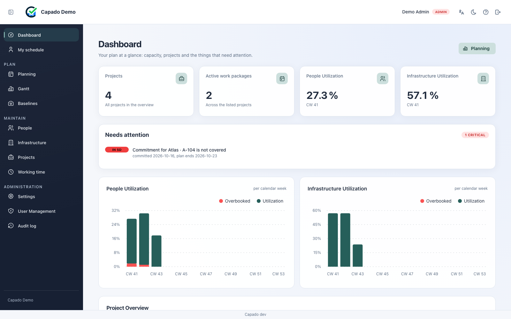
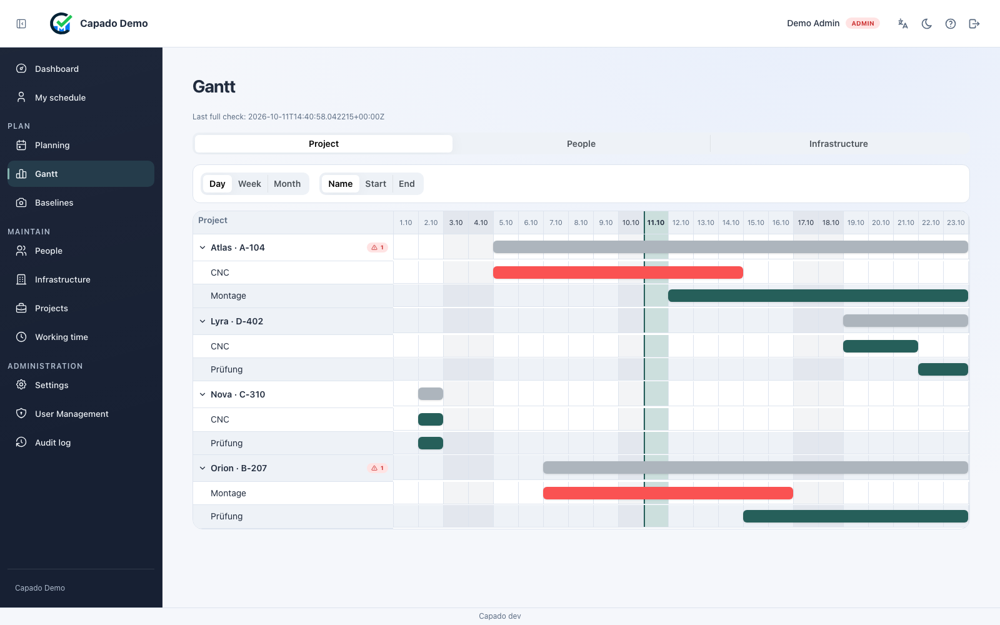
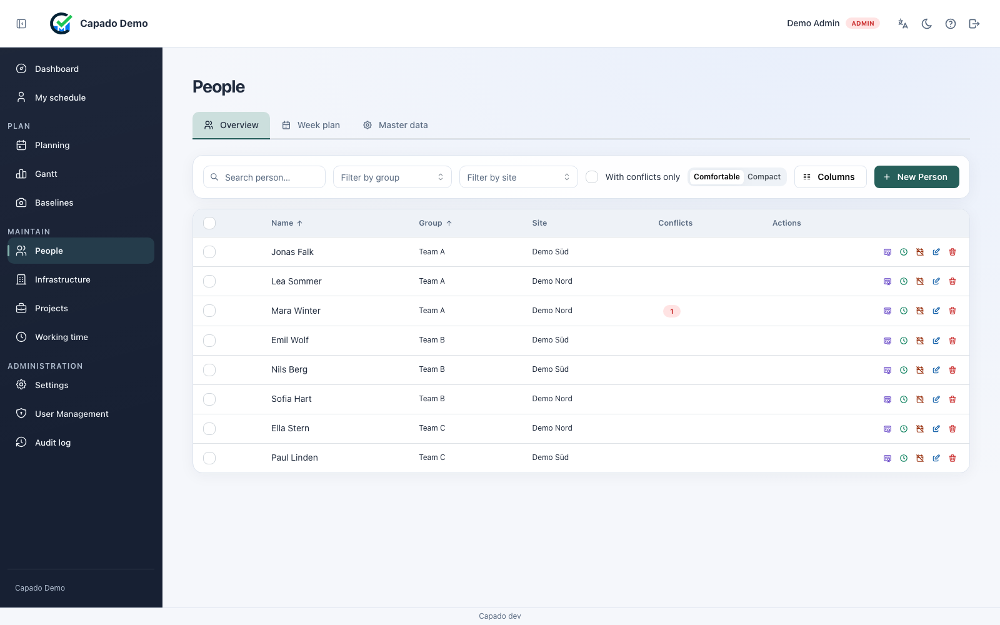

# Capado

*Capacity Done.*

**English** · [Deutsch](index.de.md)

Capacity planning for **people and machines** in one model, with skill matching. Self-hosted,
GPL-3.0-or-later.

---

## The problem

In a workshop or a production hall the same people and the same machines compete for the same hours.
Who works on which order, and when, additionally depends on who is **allowed** to: a welding
certificate, a crane licence, a forklift permit — each with an expiry date.

Almost everywhere this planning lives in a spreadsheet. That works until three things happen at once:
somebody overbooks a person without noticing, a certificate expires in the middle of an order, and
nobody can say any more what the plan looked like last month when it was reported.

Capado is built for exactly that point. It plans people **and** equipment in one model, checks
qualifications against the date the work happens, and reports overload the moment it appears.

## Who it is for

Small and mid-sized manufacturing, maintenance and workshop operations that plan orders across weeks
and months, whose work depends on qualifications, and who want — or are required — to keep their data
in-house.

Explicitly **not** a time-tracking system. Capado plans what is intended; it does not record what was
actually worked ([ADR-009](decisions/009-no-actual-time-recording.md)). That is a deliberate boundary,
and it simplifies works-council agreement considerably.

## What it does

**One model for people and equipment.** A track, a paint booth and a welder are scheduled the same
way, because in a real plan they constrain each other.

**Qualifications with a validity date.** A requirement is matched against the qualification a person
holds *on the day the work happens* — not against the one they hold today. A certificate expiring
mid-order is a conflict, not a surprise.

**Conflicts as they arise.** Overbooking, missing qualifications and window violations are detected
when the assignment is made, and collected on one page instead of being discovered at the next
handover.

**Plan snapshots.** A baseline freezes the plan as it was reported, so "what did we say in March"
remains answerable after March.

**A change log.** Every write is recorded with who, when and what changed, retained for 24 months.

**Self-service.** A person linked to their scheduled resource can read their own assignments,
absences and qualifications — read-only, and without asking a supervisor.

## What it looks like

The screenshots show a demo instance with **invented data**. Names, sites and projects are fictional
and bear no relation to any real operation.

**The dashboard combines figures and things that need attention.** Four cards show projects, active
work packages, and people/infrastructure utilization. Charts show utilization by calendar week;
the attention list brings upcoming problems together by urgency.

**The project Gantt shows work packages and conflicts.** Project bars stay neutral; regular
work-package bars use the company accent. Red marks conflicts. Expanded projects show their work
packages; collapsed rows show their conflict counts.

**People and infrastructure have separate overviews.** Filters, groups and sites help narrow the
selection. The people table shows conflicts and provides the corresponding editing actions.

## What it deliberately does not do

Being clear about the boundaries is part of the design, not an omission:

- **No time recording.** See ADR-009 above.
- **No multi-tenancy.** One installation serves one organisation
  ([ADR-003](decisions/003-single-tenant-and-sites.md)).
- **No automatic scheduling.** Capado suggests qualified resources; a human decides.
- **No self-service password reset.** An administrator sets a new one
  ([Known limitations](reference/known-limitations.md)).

## Getting started

The [local setup guide](how-to/local-setup.md) brings up backend, frontend and PostgreSQL with Docker
Compose and creates the first administrator.

For an existing installation, [Upgrading](how-to/upgrading.md) is the one to read first — migrations
run automatically at container start, so deploying **is** the upgrade.

## Where to look next

| If you want to | Read |
|----------------|------|
| understand how capacity is computed | [Capacity model](explanation/capacity-model.md) |
| understand how conflicts are found | [Conflict detection](explanation/conflict-detection.md) |
| see the shape of the system | [Architecture](explanation/architecture.md) |
| call the API | [API reference](reference/api.md) |
| move data in and out | [Import and export](reference/import-export.md) |
| know what is missing | [Known limitations](reference/known-limitations.md) |
| know why something is the way it is | [Decisions](decisions/README.md) |

## Status

The [known limitations](reference/known-limitations.md) page is kept current on purpose, and it is the
one to read before committing to Capado: it is more useful than a feature list, because it tells you in
advance where you will hit a wall.

Each release notes what changed. Pin a version rather than tracking `latest` for anything you depend
on — see [publishing a release](how-to/publishing-a-release.md) for what the image tags mean.
